 

 

<h2 align="center">Olá, sou o Simão</h2>

Sou finalista de **Informática e Gestão de Empresas** no Iscte e faço parte do **departamento de IT da Iscte Junior Consulting** há mais de um ano, onde construo soluções web e acompanho projetos de ponta a ponta. A nível europeu, sou **IT Associate na Junior Enterprises Europe**.

Com interesse em **cibersegurança**, sobretudo a vertente de **estratégia e arquitetura**, mas quero explorar também o lado prático entre **Blue Team e Red Team**.

  

<h2 align="center">Tecnologias</h2>

  

  

<h2 align="center">Projetos</h2>

  

> Grande parte dos projetos em que trabalho regularmente são privados (clientes e júnior empresa).

  

<h2 align="center">Fora do código</h2>

Sou **mergulhador certificado** e adoro mergulhar. Tem mais em comum com o meu trabalho do que parece: debaixo de água tudo gira à volta de planeamento, redundância e gestão de risco.

 

<b>English summary</b>

 

Final-year student in **Computer Science & Business Management (Informática e Gestão de Empresas)** at ISCTE-IUL, member of the **IT department at Iscte Junior Consulting**, and **IT Associate at Junior Enterprises Europe**.

Interested in **cybersecurity**, mainly **strategy and architecture**, with a growing curiosity for Blue Team / Red Team. Currently working with React, Next.js, Docker, Firebase, PayloadCMS, Vercel, MongoDB and PostgreSQL. Certified scuba diver. Based in Lisbon, Portugal.

